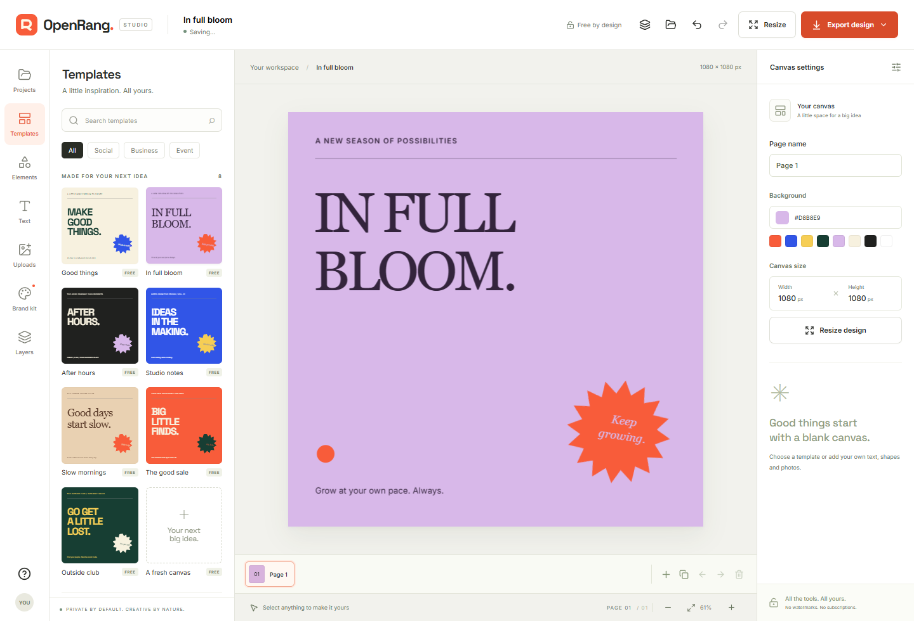

# OpenRang Studio

### Your ideas. Your canvas.

[](https://github.com/7se7en72025/openrang/actions/workflows/check.yml)

A free, open-source design studio with transparent exports, multi-page projects, brand kits and real on-device background removal.



**No account. No watermark. No API key.** Your designs and photos stay in your browser. OpenRang is independent of Canva and does not import its proprietary files or assets.

## Create, save, come back tomorrow

- Start with eight original templates, or a blank canvas.
- Save multiple designs in a local library; duplicate, search, trash and restore them.
- Use up to 20 pages per design. Add, duplicate, name, reorder and undo deletion.
- Edit text, shapes and photos with transforms, alignment, named layers, hide/show, lock and group/ungroup.
- Copy/paste, duplicate and nudge layers with keyboard shortcuts; zoom and scroll for detailed edits.
- Crop photos to useful ratios, reposition the crop, flip, and adjust brightness, contrast, saturation or grayscale.
- Remove photo backgrounds with real AI in a cancellable worker. Your original stays recoverable with Undo.
- Keep a brand kit with colors, a font and a logo; download and restore its backup.
- Export transparent PNG, JPEG, SVG, multi-page PDF or an editable OpenRang project.
- Edit offline after the first successful online visit. Install the web app where your browser supports it.

## Run it

Use Node.js 24 LTS and npm.

```sh
git clone https://github.com/7se7en72025/openrang.git
cd openrang
npm ci
npm run dev
```

Build and preview the production app:

```sh
npm run build
npm run preview
```

Serve `dist/` over HTTPS on a static host. No server, database, paid service or secrets are needed. Fonts are bundled. The offline service worker is enabled in production, on HTTPS or localhost.

## Your work is local

Designs and the brand kit live in IndexedDB on this device. **Download project backups for important work.** Clearing site data removes the local library; this is not cloud storage.

File imports stage their contents before replacing the canvas. Switching designs waits for the current save. Autosave failures are shown rather than reported as success. Version 1 project files are migrated to the multi-page format; imported copies receive a separate library identity.

Trash is recoverable. Open another design before moving the currently open design to Trash. This release intentionally offers no permanent-delete action.

## Free Pro-style tools

**Background removal:** uses [IMG.LY](https://github.com/imgly/background-removal-js) and CPU ONNX inference. The model/runtime assets download from IMG.LY on first use (tens of MB); your image is processed locally. Inference runs in a worker, supports cancellation and releases its idle runtime. Results depend on the image and device. Empty masks preserve the original photo and show an error.

**Resize:** custom sizes with proportional fit-and-center scaling. This does not automatically redesign a composition.

**Export:** PNG/JPEG at 1×, 2× or 3×, transparent PNG/SVG, and all pages in one PDF. SVG retains font names, so the receiving device needs those fonts. PDF embeds RGB raster pages; CMYK, bleed and editable PDF text are not supported.

**Offline:** the core editor, bundled fonts, local library and PNG/JPEG/SVG/project downloads work after core assets are cached. PDF and AI may need an online first use. Offline readiness depends on the browser completing installation and retaining its cache.

## Checks

```sh
npm run test:unit
npm run build
npm run check:bundle
npx playwright install chromium firefox
npm test
```

Local Chromium tests use installed Google Chrome; CI uses bundled Chromium. Firefox uses Playwright's browser.

To exercise the actual production build, offline reload and real AI:

```sh
TEST_PRODUCTION=1 TEST_AI=1 npm test
```

PowerShell: set `$env:TEST_PRODUCTION='1'` and `$env:TEST_AI='1'` first. CI builds the application and exercises this same production path. Tests cover project migration, image sharing, undo, multi-page PDF, crop/filter persistence, group geometry, storage failures, rejected imports, library recovery, responsive layout, worker cancellation, real inference and offline editing.

## Optimization with evidence

The supported CPU inference build omits the unused GPU fallback binary and shares its runtime imports: deployed asset bytes dropped from **27.2 MB to about 2.51 MB** in the recorded build. This is a roughly **91% artifact-size reduction**, not a claim about initial-load speed.

Photos are interned once in Undo history and once in project files even when shared across pages. Typing/slider changes coalesce, persistence is debounced, library listings load small metadata records, and PNG/JPEG export uses Blobs.

See [performance measurements and budgets](docs/performance.md) and [verification notes](docs/verification.md). Bundle budgets are enforced in CI.

## Boundaries

OpenRang is a complete local design workflow, not full Canva parity. It has no cloud sync, live collaboration, video/animation editor, stock-media library, generative-image service or proprietary-format import. Safari and real mobile hardware remain unverified.

- Canvas: 100–6,000 px per side, up to 20 pages.
- Per page: 300 elements, 100 groups, at most four nested group levels.
- Images: PNG/JPEG/WebP, up to 12 MB and 25 megapixels.
- Saved projects: 24 MB; imported files: 25 MB. Embedded assets are shared.
- Raster exports: up to 40 megapixels per page.
- History: up to 50 snapshots with an approximate 48 MB string-data budget; at least two snapshots are retained. Large documents can still use significant memory.
- One local brand kit. No custom font upload.
- Autosave waits 450 ms; keep the tab open until it confirms completion.

## Architecture and contributing

React + TypeScript + Vite, Fabric.js, IndexedDB, jsPDF and IMG.LY/ONNX Runtime. Native web platform features provide workers, file downloads and offline caching.

- `src/editor.ts`: canvas mutations, pages, history coordination and exports.
- `src/project.ts`: validation, migration, asset packing and atomic local persistence.
- `src/history.ts`: shared-image undo snapshots.
- `src/StudioPanels.tsx`: projects, pages, layers, crop/adjustments and brand restore.
- `src/background.worker.ts`: isolated CPU segmentation.
- `src/App.tsx`: editor shell and properties.

[REA research notes](docs/research/canva-investigation.md) record a real Canva capture that reached a Cloudflare challenge. Live editor behavior was not verified; Canva internals were not copied.

See [CONTRIBUTING.md](CONTRIBUTING.md) and [CHANGELOG.md](CHANGELOG.md). **AGPL-3.0-only**; upstream notices are in [NOTICE.md](NOTICE.md) and `public/licenses/`. Original templates may be used in your exported designs.
