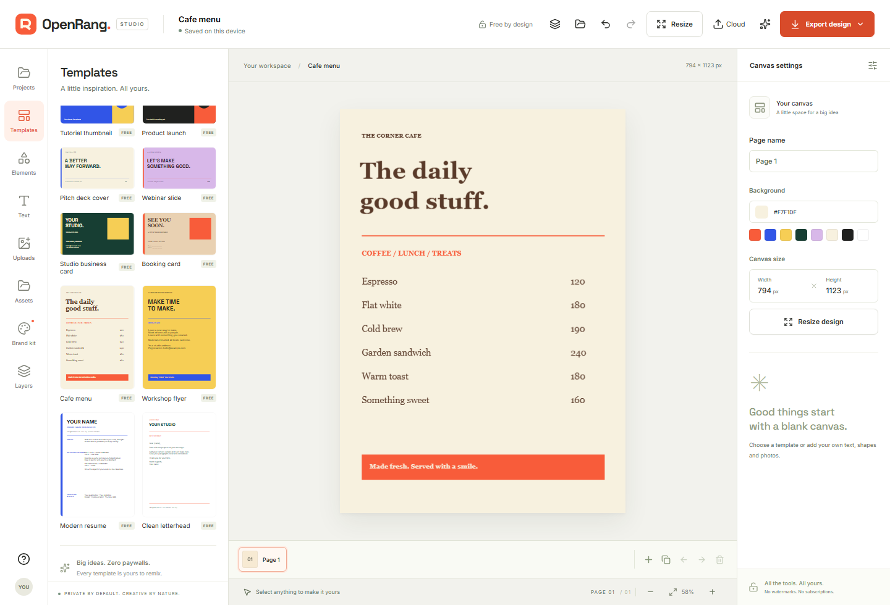

# Design-tools completion checklist

This release finishes the scope selected by the user: **fonts, effects, templates and a reusable asset library**, integrated with the existing design/save/export workflow. It does not claim every Canva Pro feature or proprietary file compatibility.

| Workflow | Delivered behavior | Verification |
| --- | --- | --- |
| Custom fonts | Upload WOFF2/WOFF/TTF/OTF; validate header, size, identity and native decoding. Embed in project/SVG; reuse through kit/library. Remove unused fonts and recover with Undo. | Actual WOFF2 browser load, JSON/SVG export, reload, kit reuse, rejected corrupt/tampered data, pooled-font model check. |
| Effects | Outline/color, shadow/color/blur/offsets, letter/line spacing, underline and strikethrough. | Browser edits and project roundtrip; validator rejects unsupported shadows. |
| Templates | 20 starting designs including blank, with 12 additional original layouts in real story, thumbnail, slide, card and document formats. | Every authored layout validated; browser checks all new dimensions and edits exported text. |
| Reusable library | Local photos/fonts, search/type filter, thumbnails, reuse across designs and independent removal. Six editable original graphics. | Reuse, removal followed by reload/import, simultaneous uploads, failed-index rollback. |
| Existing workflows | Legacy imports, shared asset pooling, autosave, project backups, PNG/JPEG/SVG/PDF/video and optional team sync. | Production regression suite plus the new model/browser checks. |

## Supported limits

- Custom fonts: eight per project or kit, 2 MB per file, 6 MB encoded font data total. Separate face/style files may be uploaded independently. Rendering depends on the browser decoder. SVG embeds custom font data; built-in fonts remain named references.
- Local library: 40 photos/fonts and 64 MB. Metadata and thumbnails are separate from full files. Storage failures preserve the source/current design. Assets are the user's local files and original graphics; no account-backed stock-photo catalogue is included.
- Existing page, image, document, cloud and video limits remain in README. Cloud save uploads embedded fonts/photos only when explicitly chosen.
- Safari, physical mobile hardware and two real hosted Sites accounts remain unverified. Browser QA uses Chromium/Firefox, an actual uploaded WOFF2 font and real AI inference; cloud QA uses an R2 contract adapter behind the production Worker.

Full clip/audio timelines, generative-image services, stock-media integrations, shared cursors/object-level conflict merging and Canva proprietary-format import are separate product scopes. They are not represented as part of the four completed design-tool workflows above.

